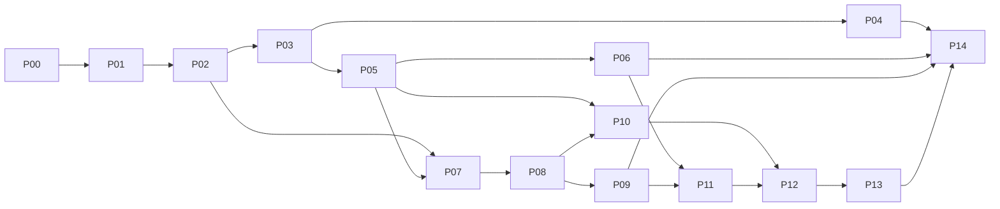

# Operon backend engine implementation plan

**Handoff specification — design only — 2026-11-07**

> **Implementation status:** an initial delivery is recorded in
> [server_engine_progress.md](server_engine_progress.md), with baseline
> measurements in [server_engine_baseline.md](server_engine_baseline.md) and
> lock ownership in [engine_locking.md](engine_locking.md).  That record
> distinguishes implemented, opt-in, simulated and deferred capabilities; this
> plan remains the target, not evidence that every package is complete.

This document is for the coding agent implementing the next backend. It defines
the complete target and an incremental delivery plan; it does not assert these
features exist in Operon 3.0.2. Use it together with
[the architecture proposal](server_engine_next.md). Where the proposal was broad,
the ordering, safety rules and acceptance criteria here take precedence.

## 0. Starting instructions for the implementation agent

1. Read `AGENTS.md`, this plan, the architecture proposal and the existing source
   entry points listed below. Inspect the working tree before editing. Preserve
   local changes and published release bytes; do not reset another agent's work.
2. Implement the application on its existing maintenance line,
   `fix/3.0.1-installation`, unless the owner specifies another existing branch.
   `main` is retained but inactive; `library/main` is independently maintained.
   Do not create a merged main, bulk-update the library or change scientific
   algorithms as part of this work. Do not create a new branch merely to rename
   the maintenance policy.
3. Freeze a baseline record: commit, dirty files, Python/OS, current test outcomes,
   registry identity and performance samples. The released application baseline
   is `c7bd2c6d73c600e899121f335a267c2c64140d94` (3.0.2/SDK 3.7); subsequent
   transfer-only commits do not change that scientific runtime. Verify current
   state rather than assuming HEAD equals this baseline.
4. Deliver the task packages in dependency order. A passing internal feature does
   not mean a delivery wave is complete. Keep the existing sequential executor
   runnable while introducing new internals.
5. For each task record the changes, tests, unresolved boundaries and rollback
   procedure. Never claim multiprocess simulation is clean-PC GUI acceptance,
   or mocked SSH is a real Linux-server test.
6. This is not permission to publish a release, remove an old installation, kill
   unrelated jobs, install arbitrary tools on a server or upload private datasets.
   Follow the implementation assignment's actual authorization for those actions.
   Do not embed credentials, machine paths or test-server identifiers in source.

Proposed final version is deliberately unassigned. Select it only after the
delivered capability set is known; do not use a version number as proof that the
entire roadmap is complete.

## 1. Product contract and scope

### Required outcomes

- Multiple desktop/CLI/MCP clients can share a server without their control
  requests serially blocking one another.
- All workspaces in one authorized execution pool share fair resource admission.
  A client connection is not a separate entitlement to RAM or CPU.
- Queue decisions react to submissions, completions and released resources.
  Resizable workers can share spare capacity safely; fixed workers remain safe.
- Independent DAG branches can overlap when the resource/capability model permits.
- Explicitly streaming-capable pipelines use byte-bounded channels and propagate
  consumer pressure upstream. Legacy operators are not relabelled as streaming.
- Attempts, outputs, checkpoints and scratch have durable ownership and recovery
  rules. Disconnects and duplicate requests do not create duplicate runs.
- CLI/API/MCP and Studio use one engine and equivalent plans. Scientific results,
  metadata and frozen parameter values remain equivalent on supported paths.
- Measure and reduce control latency, not merely add worker threads.

### Preserved behavior

- Fixed startup pool ceiling, normally 90% of detected available RAM, constrained
  by configured limits and OS/cgroup allocation; no repeated free-memory scan
  that silently changes the execution pool ceiling.
- Existing local/remote selection, route-operator uniform placement, SSH trust,
  resumable uploads, document-first registry/dependency receipts, explicit
  environment preparation, pinned execution identity and parameter JSON.
- Existing memory planning, chunked Reader preparation, mapped data and emergency
  spill. Existing scientific plugins and Form/FileArtifact contracts continue to
  work through conservative adapters.
- Existing user-configured *fixed* budgets stay fixed. Elastic allocation is an
  explicit execution policy, not a reinterpretation of a saved number.

### Separate follow-up projects

Tauri, cross-OS-user server administration, Slurm/Kubernetes/Nextflow executors,
arbitrary GPU sharing, arbitrary process-memory checkpoints, new scientific
formats and a universal plugin rewrite are outside the initial delivery. Keep
extension seams for them; do not make them prerequisites for the first server
improvements. Native allocation interception and hard RSS enforcement are not
guaranteed without supported OS mechanisms.

## 2. Repository map and traps to preserve

| Existing seam | Planned use / hazard |
| --- | --- |
| `operon/application.py` (`WorkflowService`, `TaskService`, `ArtifactService`) | Stable frontend/CLI/API/MCP service boundary; delegate to engine facade instead of creating a new public engine for each entry point |
| `operon/remote/server.py` (`serve`, `RemoteService.dispatch`) | Serial accept/dispatch loop today; replace only after shared state/idempotency is safe |
| `operon/remote/client.py:SSHConnection.call` | Per-connection lock protects a single ordered byte stream; keep it for legacy transport, add separate channels rather than removing it |
| `operon/remote/handshake.py` | Existing registry refresh already runs in background; extend capability/receipt handling, do not implement a competing installer |
| `src/web/service.py:JobService` | Launch/queue/monitor/details/cancel/shutdown responsibilities currently combined; carve out adapters and short transitions |
| `src/web/admission.py:HostAdmission` | Existing fixed-session pool and shared file ledger; sole allocator in legacy mode, not a second allocator beside the new coordinator |
| `src/web/execution.py:ExecutionService` | Existing stage orchestration and `completed_units`; preserve these IDs/retry boundaries while routing scheduling through the coordinator |
| `src/task/runner.py:run` | Keep as initial sequential execution unit; do not share its Context across parallel nodes |
| `src/task/memory/runtime.py:MemoryRuntime.update_budget` | Existing between-step resize hook; rejects active store use and rolls back the setting on failure; not mid-chunk resizing or a distributed lease protocol |
| `src/task/memory/planner.py`, `store.py` | Lifetime positions/next-use/release logic assumes linear execution; use one store per sequential unit until DAG-level ownership is designed |
| `operon/exchange.py`, `wire.py`, `isolation.py` | Reuse verified metadata/file transport, mapped input ingestion, pull/ACK semantics; audit control-event queues separately for boundedness |
| `src/web/models.py`, parameters helpers, `operon/workflow_spec.py` | Preserve strict YAML, execution sidecars, defaults and frozen values; add versioned optional engine policy through these shared models |
| `operon/remote/transfers.py` | Retain upload receipts/dedup/resume; add concurrency-safe ownership rather than replacing transfer formats |

Specific concurrency defects to test *before* enabling threads:

1. Remote `run` currently scans prior jobs by request ID before launching. Two
   concurrent calls can both miss the prior job without an atomic durable claim.
2. `transport_leases` is a mutable dictionary; timeout cleanup must not release a
   reservation while a concurrent transfer still owns a buffer.
3. A 128 MiB maximum individual control frame does not bound aggregate request
   memory. Admission must occur before accepting all bodies.
4. Socket inactivity timeouts alone permit slow-drip clients to hold handlers.
   Add an absolute total-frame deadline and header/body accounting.
5. Job start/cancel/details paths contain blocking work near or under state locks.
   Cancellation must not wait for process termination while holding the shared
   state lock. Read endpoints must not repeatedly parse large report files there.
6. Idle daemon shutdown must account for queued work, transfers, inflight handlers,
   maintenance and active leases, not just running processes.
7. Existing orphan-owner and cross-launcher cancellation behavior is not a durable
   coordinator policy. Audit `_refresh_jobs`, `cancel` and `shutdown` explicitly;
   do not accidentally kill a healthy adopted worker or refuse authorized control.
8. Catalog replacement currently updates mutable service state. Use an immutable
   generation snapshot so validation, dependency receipts and execution pinning
   cannot observe a mixture of two catalogs during concurrent refresh.

`TaskService._submit` already has durable file receipts and per-key locking. Reuse
its conflict/uncertain-submission semantics when replacing history scans with
transactional indexes; do not regress this working behavior while fixing the
separate remote scan-then-launch path.

## 3. Target boundaries and proposed module layout

```text
operon/engine/
  contracts.py        immutable plan, request, resource and event records
  state.py            transactional repository, schema versions, outbox
  facade.py           shared application operations and compatibility views
  coordinator.py      short command loop, readiness, attempts, launch outbox
  policy.py           pure fairness/candidate selection functions
  resources.py        pool accounting, atomic leases, resize transitions
  executor.py         executor interface and existing-worker adapter
  supervisor.py       process-tree identity, launch receipts, worker recovery
  events.py           durable cursors, snapshots, bounded subscriptions
  artifacts.py        immutable artifact manifests, commit/reconciliation
  retention.py        reference-aware scratch/cache cleanup
  recovery.py         restart reconciliation and resume validation
  channels.py         byte credits, block references, close/failure protocol
  telemetry.py        local metrics/spans and benchmark hooks
```

These are proposed responsibilities, not an instruction to create empty modules
all at once. Split/merge small modules when it improves cohesion, but preserve
ownership boundaries. A scientist's operator must not import a UI server to use
the execution engine.

The control server accepts bounded requests and responds from snapshots or posts
commands. One coordinator state writer owns transitions; I/O and workers run
outside that loop. Executors cannot grant resources. Workers cannot change grants
without a coordinator decision. The artifact service cannot publish data without
the active attempt's fence.

Default pool identity combines an OS principal with a configured capacity domain
and stable pool ID. It must survive reconnects and must not be just a hostname or
workspace path. Do not double-count overlapping cgroup budgets. Unsupported shared
or nested capacity configurations require explicit configuration or conservative
serialization, not independent allocators each claiming the same host RAM.

Use a private Unix socket behind SSH on Linux. On Windows use the existing local
authenticated IPC capabilities or a scoped pipe/socket equivalent with access
control. No new unauthenticated public listener is required. Application APIs can
expose the same facade through their existing authorization layer.

## 4. Durable model and persistence rules

SQLite WAL on a local filesystem is the initial engine-state store. Use one
writer, bounded transactions, schema versioning and an event/outbox transaction.
NFS is allowed for data only where existing I/O contracts allow it, not for this
database. Configure the control database location independently of a network
workspace. Report unavailable/corrupt state clearly; do not silently recreate it.

| Record | Minimum fields and constraints |
| --- | --- |
| Pool | ID, principal/capacity domain, startup snapshot, ceiling, control reserve, policy revision, coordinator epoch |
| Workspace | ID, resolved root, principal/project policy, legacy/new ownership mode |
| Request | principal, idempotency key, canonical request digest, operation/run ID, durable receipt; unique `(principal,key)` |
| Run | ID, workspace/project, frozen graph/parameters/execution references, plan key, status/revision, cancellation flag |
| Unit | ID within run, dependency IDs, selected host/environment, adapter capability, resource envelope, state |
| Attempt | ID, ordinal, epoch/fence, state/revision, process identity, timestamps, exit/error classification, receipt paths |
| Lease | ID, attempt owner, committed resource vector, target vector, resize epoch/state, heartbeat and reconciliation state |
| Artifact | immutable ID, producer fence, typed manifest, content digest, size, publication state, storage location, retention pins |
| Reference | artifact/block, consumer/attempt owner, reason, lifecycle; unique owner/reference identity |
| Event | monotonically increasing cursor, principal/workspace/run/attempt, type, compact payload, commit time |
| Outbox | unique command/attempt ID, launch/stop/notify command, retry bookkeeping and acknowledgement |

State updates, event insertion and outbox insertion commit together. A worker
launch never occurs inside that transaction. A persisted launch command is not
proof the worker started: the supervisor uses a unique attempt/fence and a launch
receipt to reconcile replay. Process identity includes PID and creation identity;
where available include host boot identity to detect reuse after reboot.

Request-key reuse with different content is a conflict. Retain receipts/tombstones
according to an explicit policy; do not claim indefinite idempotency after receipt
deletion. A client retry must use the same key. Scientific execution can be
at-least-once across a crash; controlled artifact publication and deduplication do
not make arbitrary external side effects exactly-once.

Lease the selected environment generation as well as data artifacts. Build/repair
managed dependencies in a separate generation, validate it, then atomically select
it for future attempts. Retain old generations while any attempt uses them. Where
the existing adapter cannot provide immutable generations, serialize Operon-owned
environment mutation against active users instead. Catalog immutability alone does
not protect running code from concurrent package replacement. External environments
modified outside Operon are not guaranteed immutable; invalidate their receipts
according to the existing explicit refresh policy and document that boundary.

Legacy `job.json` remains readable and may be generated as a compatibility view.
For a migrated record, the engine database is authoritative; do not allow JSON
and SQLite to act as independent writers. Historical record import is versioned,
idempotent and preserves original bytes and IDs.

## 5. Interface contracts

Use typed internal records first; publish JSON schemas/OpenAPI only at the shared
service boundary. Proposed names below are logical operations, not a mandate to
break existing CLI flags or MCP tool names.

| Operation | Inputs | Output and important semantics |
| --- | --- | --- |
| Submit | frozen plan reference, validation receipt, request key | durable operation/run ID after atomic claim; no scientific work in handler |
| Status/list | authorized IDs, revision/filter, page cursor | immutable compact snapshot; bounded page/response bytes |
| Cancel | run ID, expected revision, reason | durable acknowledgement; actual terminal cancellation follows process-tree stop |
| Events | filters, after cursor, event/byte limits | resumable lifecycle deltas; expired cursor explicitly requests a snapshot |
| Environment prepare | authorized target/recipe identity, key | deduplicated maintenance operation using existing preparation machinery |
| Lease acquire | attempt/fence, complete resource request | atomically all resources or none; no partial CPU/RAM deadlocks |
| Lease resize | lease/fence, old revision, requested/target bytes | revisioned proposal/grant/ack protocol, never implicit free-RAM inference |
| Artifact commit | attempt/fence, staged manifest, verified digests | immutable committed references after fence/ownership validation |
| Resume | prior run/unit, desired unchanged inputs/plan | verified reuse decisions and new attempts for remaining work |

Errors have stable machine codes: busy/retry-after, unauthorized, stale revision,
idempotency conflict, capability unavailable, infeasible resources, unsupported
resize, stale attempt, corrupt artifact and unrecoverable state. Preserve existing
user-facing translations through adapters; do not force agents to parse prose.

Support request IDs and absolute deadlines through all hops. Same-host internal
deadlines use monotonic elapsed time; remote deadlines need an explicit remaining
time contract rather than comparing unsynchronized wall clocks.

### Configuration ownership

Pool configuration owns total ceilings, fairness weights/quotas, service reserves,
control byte limits, handler limits, event retention and execution-mode rollout.
Workflow `execution.json` owns requested target, fixed/elastic policy, task budget,
permitted retries and result-retention preferences within pool policy. Attempts
store actual grants/adjustments separately; those must not modify frozen workflow
values. Version new policy fields, provide old defaults, and round-trip them through
YAML/UI/CLI/API consistently. Do not invent mandatory operator parameters for them.

Initial deployment mode is `legacy`, `shadow` or `coordinator`, scoped to a pool.
Shadow mode may compute decisions and record diagnostics, but cannot issue leases,
launch processes, change budgets or delete data. Admission authority is exclusive.

## 6. State machines and failure semantics

### Attempt lifecycle

```text
blocked -> ready -> admitted -> starting -> running -> committing -> succeeded
                          \           \          \             \
                           ---- failed / cancelled / recovery-required
```

Cancellation is a persisted request flag while cleanup runs. The public task is
not terminal-cancelled until its process tree has stopped and output policy has
been reconciled. Completion/cancel races use revision/fence checks; an already
committed success must not be rewritten into a false failure.

Output commit is not resource release. A successful parent with live owned native
children still consumes its process-tree reservation. Either wait for owned
descendants before terminal success, or retain a visible cleanup lease until
confirmed termination; never release resources solely because results exist.

Allowed transitions are centralized and tested as a table. Retrying creates a new
attempt ordinal and preserves prior logs. No generic `paused` state promises
resuming arbitrary process memory. Only a checkpoint-capable adapter can expose
pause/resume; otherwise stop/retry is explicit.

### Ownership and loss of contact

- Client disconnect: detach subscription/session; jobs and leases survive.
- Worker heartbeat lost: mark suspect, stop granting its resources elsewhere,
  reconcile process identity/heartbeat channels. A timeout alone does not prove death.
- Coordinator crash: reacquire exclusive pool ownership, advance epoch, reconcile
  supervisors/attempts before dispatch; old fences cannot publish new outputs.
- Launch reply lost: reconcile the existing attempt receipt; do not launch again
  simply because the outbox entry was not acknowledged.
- Proven worker death: release resources, retain/clean attempt state by policy,
  classify retry eligibility. Unknown ownership remains quarantined and visible.

Choose per-executor adoption support explicitly. Initially, live workers can be
adopted only through a tested supervisor contract; otherwise controlled termination
and checkpoint retry is safer than pretending they were adopted. Replace the old
orphan-owner policy only for jobs owned by the new engine.

## 7. Resource algorithm and resize protocol

Represent resources as integer bytes/slots and explicit device IDs. Separate
committed grants, proposed target grants and measured consumption. Measurements
calibrate estimates and detect pressure; they do not define disposable credits.

The resource record must distinguish `managed_budget_bytes` from
`process_reservation_bytes`, plus `scratch_reserved_bytes` and
`transport_reserved_bytes`. Managed budget covers local store/workspace planning;
process reservation includes interpreter, native allocator and child-process
overhead. `JobService._watch`'s process limit must agree with the active lease.
Do not use one ambiguous `budget` field for all of these quantities.

For a fixed startup ceiling `C` and management reserve `H`:

`sum(worker committed grants) + shared buffer charges + transfer charges <= C - H`.

Account for interpreter/native workspace, pinned inputs, output staging, metadata
and IPC. A shared block has one physical pool charge with multiple references.
Mapped/spilled bytes need distinct resident/disk accounting; file-backed does not
mean zero memory pressure. Scratch capacity and bounded I/O concurrency are separate
constraints. Unknown operator peak memory requires conservative admission, not
optimistic oversubscription.

### Dispatch algorithm

Maintain dependency counters, per-principal/project ready queues and incremental
resource totals. On a meaningful event, examine a bounded candidate set, rank by
weighted fairness plus age, test complete feasibility, atomically reserve, record
attempt/outbox, then launch outside the lock. Avoid exponential subset search.
Offer pure policy functions for deterministic replay/simulation.

Reconnects or new workspaces cannot manufacture entitlement. Projects inherit
principal quotas. Protect an aged feasible large job by accumulating capacity and
limiting new competing admissions. Backfill cannot delay that reservation unless
the execution bound/preemption guarantee is established. Oversized jobs fail
clearly; infeasible jobs must not permanently head-block the queue.

### Elastic grants

A resizable adapter declares minimum-progress, preferred and upper bounds. Full-mode
legacy execution remains fixed for an active step. Initially enable resizing only
between steps through `MemoryRuntime.update_budget`; chunk-boundary resizing is a
later streaming-adapter capability.

Shrink sequence:

1. Persist a proposal with lease revision/resize ID; keep old committed credits.
2. Worker reaches a supported safe point and prevents the next step from starting.
3. Under local store synchronization, validate feasibility, evict/spill eligible
   blocks, update the local budget and report the managed limit separately from
   any verified process-reservation release.
4. Coordinator validates fence/revision and the release guarantee, updates the
   process watchdog coherently, commits the lower process grant and publishes
   returned credits. Only then can another worker receive them.
5. Lost ACK/repeated messages are idempotent. Refusal or timeout retains the old
   committed grant; the coordinator must not infer successful release from low RSS.

Growth ordering is explicit: reserve global credits, raise the supervisor/process
watchdog limit, send the revisioned permission, then let the worker raise its
managed budget. Persist the last-applied revision. A lost growth ACK keeps the
additional credits charged until reconciliation or proven process-tree termination.
Minimum-progress workers cannot all retain memory
while waiting indefinitely for growth; they must progress/spill at the minimum or
checkpoint and requeue. Detect and reject an invalid minimum guarantee.

CPU limits are initially fixed per attempt/step; existing thread environment limits
are advisory for some native tools. Optional delegated Linux cgroups can enforce
limits, but missing permission must be reported. GPU starts exclusive per declared
device and only for an executor that verifies device ownership. No generic memory
scaler should claim it can shrink CUDA allocations or running subprocess heaps.

**Conservative first implementation:** a successful `update_budget` is not proof
that RSS/native allocations have been released; Python allocators may retain
pages. Decreasing managed budget alone never returns process credits. Reclaim
process reservations at process completion or a verified supervisor restart with
immutable handoff first. Active-process lending requires a separately tested
accounting/enforcement capability, including native children and watchdog updates;
unsupported workers refuse it. Never lower an OS limit opportunistically and
cause an unannounced OOM to make the accounting look correct.

Reuse the numerical allocation example in the architecture proposal as a unit
test: 56 GiB execution pool, initial grants 24/16/16, new cooperative unit D,
target 20/12/12/12. Assert D cannot start before all required release ACKs.

## 8. Artifacts, recovery and storage

Each execution unit/attempt has its own Context and linear memory store initially.
Parallel branches exchange immutable, verified artifacts through `operon.exchange`
adapters. Never reuse one linear `LifetimePlan.position` across parallel workers.
Measure process/input-copy overhead and keep small or stateful chains grouped when
splitting them would be slower or semantically unsafe.

Use the attempt directory structure in the architecture proposal. Output staging
is private to the attempt. A commit receipt identifies producer fence, manifests,
digests and result identities. Verify before atomic publication. File rename and
database registration are not one transaction: add an explicit recovery table
for crashes before/after staging flush, rename, receipt publication and DB commit.
Use filesystem-appropriate durability primitives and test the supported guarantees.

Resume/cache keys include immutable input content identities, frozen parameter
values, relevant I/O semantics, implementation/environment/tool/converter identities
and explicit randomness inputs when relevant. Do not include current UI text or
changed defaults as execution identity. Do not use size/mtime alone as proof of
scientific cache equivalence. Unknown environment/side effects disable reuse.

Cache/GC is reference-aware. Active attempts, downstream consumers, published
results and retained checkpoints pin artifacts. Mark candidates, verify ownership
and paths, then delete; record partial failures and retry safely. No cleanup may
traverse arbitrary user-input paths. Quotas cause bounded waiting, deliberate
eviction of unpinned cache, or explicit resource errors, not unbounded spill.

The current run-private spill store uses trusted private pickle metadata. It is
not a portable checkpoint or cross-run cache format. New reusable/remote artifacts
must use the verified safe exchange encodings; never import another run's
`metadata.pkl` as an optimization.

## 9. Streaming data plane and backpressure

Introduce streaming groups only after lifecycle, resource ownership and immutable
artifacts are established. An adapter must explicitly declare its stream mode,
chunk shape/order constraints, minimum buffers and cancellation/checkpoint rules.
Legacy source analysis cannot infer these guarantees. Keep these execution
capabilities versioned and separate from SDK 3.7 format compatibility; do not
claim two matching Form ports are automatically stream-compatible.

Channel operations: `reserve(max_decoded_bytes)`, `publish(block_ref, sequence)`,
`receive`, `ack(reference)`, `close(end_reason)` and `cancel`. Persist only what
is needed for supported checkpoints; a channel's in-flight RAM is not a checkpoint.

Credits must be acquired before materialization, including decoded bytes, metadata
and temporary buffers. Bound both bytes and in-flight block count. Start with the
existing safe file/mapped wire representation; shared-memory/ring-buffer optimizations
require separate lifetime and cross-platform tests. No pickle transport.

Existing `np.nditer` chunk views may reuse buffers. An asynchronous producer must
copy into an admitted owned block or retain the producer until the consumer has
released the borrowed view; enqueueing successive views without ownership corrupts
data. ACKs include block ID and generation so a delayed ACK cannot release a reused
slot. Streaming resume requires adapter state, source cursor, partition/order
metadata and input identities, not just the last chunk number.

Fan-out shares immutable references and returns physical credits only after all
required consumers release them. A slow required branch applies pressure upstream.
Disk decoupling is optional, bounded and charged to its own lease. Joins specify
matching/ordering and bounded waiting; they cannot retain unlimited unmatched input.

Admit enough of a streaming group, its channels and at least one feasible progress
path together. Otherwise a producer can consume the pool while its consumer waits
for admission. Test this scheduling deadlock deliberately. Failed/cancelled consumers
close channels and propagate termination; retries never treat partial output as
committed data.

## 10. Concrete task packages

Each package is a reviewable delivery. Suggested filenames are new tests unless
already present; inspect the repository before creating a duplicate test suite.

### P00 — Baseline and observability

- **Depends:** none. **Seams:** remote client/server, service lock boundaries,
  `docs/design`, a new benchmark harness under `scripts/benchmarks/`.
- Add local request/run/attempt correlation IDs, queue/handler/lock/launch spans,
  bounded metrics aggregation and redaction. Keep metrics opt-in/low overhead.
- Benchmark the existing release: multiple clients, one slow request/slow socket,
  large upload, dependency operation, cancellation and mixed short/long jobs.
- **Accept:** reproducible commands, hardware/network/environment manifest,
  raw samples and p50/p95/p99; reproduce head-of-line behavior without user data.
- **Deliver:** baseline report and performance budget; no concurrency claims yet.

### P01 — Engine contracts and compatibility facade

- **Depends:** P00. **Seams:** `operon/application.py`, new contracts/facade,
  shared execution config and handshake schemas.
- Define request/plan/attempt/resource/error records and explicit mode/capability
  negotiation. Wrap current JobService behind the executor/facade interfaces.
- **Accept:** existing CLI/API/MCP/headless workflows still use one path; YAML and
  JSON preserve unknown-compatible/known fields according to the actual strict
  schema policy; fixed parameters/budgets unchanged; unsupported features explicit.
- **Tests:** existing headless/server CLI/execution/readiness suites, plus facade
  contract tests using the legacy executor. Do not switch allocator ownership.

### P02 — Durable requests, transitions and outbox

- **Depends:** P01. **Seams:** state repository, remote `run`, TaskService.submit.
- Implement versioned DB, atomic request claim, transition/event/outbox transaction,
  duplicate/conflict behavior, compatibility record import and rollback backup.
- **Accept:** 100 simultaneous identical authorized requests have one durable run
  identity; different content under the same key conflicts; crash after commit
  before reply returns the same receipt on retry. Replay produces one durable
  run/outbox identity; actual process-launch deduplication is accepted in P07.
- **Tests:** `test_engine_state.py`, `test_engine_idempotency.py`; process barriers
  and injected crash points, not just single-thread mocks.

### P03 — Safe concurrent control service

- **Depends:** P02. **Seams:** remote serve/dispatch, JobService read/cancel/start,
  handshake refresh and transport leases.
- Audit a method ownership matrix; make shared-state access explicit. Extract
  process/network/disk waits from state locks; read snapshots outside mutation
  paths. Add handler and aggregate byte admission, absolute frame deadlines,
  operation-pinned transfer leases, and correct daemon liveness predicates.
- Pin environment generations or serialize environment maintenance against active
  users. Test install/run and repair/retry races, in addition to catalog refresh.
- Use separate SSH control/event/bulk channels and old-protocol fallback. Slow
  calls return operation IDs where appropriate. Deduplicate maintenance using
  existing background preparation rather than implementing another installer.
- Before enabling concurrent mutation handlers, run the single-writer command
  loop behind the still-serial gateway and prove launch/cancel/retry/stage-child
  submission/watcher/shutdown all use it. Document lock order across coordinator,
  job state, catalog/handshake, dependency session and transfer state; never await
  another executor or socket while holding a transition lock. Separate
  `close_session` from explicit `shutdown_pool(drain|cancel)`.
- **Accept:** slow client A cannot block B's status/cancel; active buffer lease
  cannot expire/release early; bounded handlers/bytes under slow-drip/large-body
  traffic; concurrent run/cancel/refresh/close does not corrupt state.
- **Tests:** `test_remote_concurrency.py`, `test_control_limits.py`, existing
  remote/transfer/handshake/slow-catalog tests and Linux socket integration.

### P04 — Durable events and responsive snapshots

- **Depends:** P02-P03. **Seams:** events module, TaskService.logs/details/list,
  remote poll adapter and frontend task-state consumer.
- Introduce cursors, conditional snapshot revisions, pagination and bounded
  subscriptions. Coalesce progress; preserve lifecycle/artifact events in durable
  storage; provide cursor-expired resync. Retain bounded polling compatibility.
- **Accept:** slow subscriber cannot block workers or consume unbounded RAM;
  reconnect recovers terminal events; duplicate/out-of-order delivery does not
  regress UI state; old clients still show correct status/logs.
- **Tests:** event restart/replay/backlog limits and targeted task-panel tests;
  no wholesale frontend redesign.

### P05 — Pool coordinator and exclusive resource authority

- **Depends:** P02-P03. **Seams:** HostAdmission, JobService scheduling and new
  coordinator/resources; workspace and pool registration.
- Build one durable queue/allocator per authorized pool across workspaces. Add
  epoch/process ownership, all-or-nothing resource grants, release reconciliation
  and launch outbox handling. Shadow the legacy policy without mutating it first.
- Migrate ownership only after drain/inventory. A queued legacy job can be imported
  once by stable ID; running legacy reservations remain charged until resolved.
- **Accept:** no double promise of capacity under races/restart; client disconnect
  preserves work; a new client sees/cancels authorized jobs submitted by another;
  different principals cannot control one another by guessing IDs.
- **Tests:** `test_engine_pool.py`, multi-process workspace admission, coordinator
  failover/lease quarantine and existing job admission/execution-service suites.

### P06 — Fair policy and event-driven dispatch

- **Depends:** P05. **Seams:** pure policy functions and coordinator ready queues.
- Implement weighted share/age selection, aggregate principal/project caps,
  infeasible-request rejection, protected aged-job reservations and bounded scans.
  Use event wakeups; retain bounded reconciliation heartbeat as redundancy.
- **Accept:** small-job bursts do not indefinitely bypass an aged feasible large
  job; ten connections do not get ten shares; decisions are deterministic on a
  recorded event sequence; control requests stay responsive under queue load.
- **Tests:** policy simulation/property tests plus real mixed jobs. Demonstrate
  fairness only under stated finite-workload/capacity assumptions.

### P07 — Supervisor and recoverable attempt lifecycle

- **Depends:** P02, P05; can develop with executor adapter independently of P06.
- Implement idempotent launch/stop, process-tree identity, lost-ACK reconciliation,
  fenced attempts, owned logs and safe restart. Replace old orphan behavior only
  for new-engine attempts. Publish cancel ACK separately from terminal state.
- **Accept:** kill coordinator before/after launch/registration; no duplicate
  execution tree or premature resource release; authorized cancellation reaches
  the full owned tree; reconnect/adoption behavior is explicit and reproducible.
- Verify retained environment-generation references and process-tree cleanup
  leases: output success cannot release resources still used by a live child.
- **Tests:** `test_engine_attempts.py`, real subprocesses on Linux and Windows,
  existing dependency-process/desktop exit regressions where affected.

### P08 — Artifact commit, attempt directories and retention

- **Depends:** P07. **Seams:** exchange/wire/context exports, artifact facade,
  new artifact/recovery/retention modules.
- Add staged outputs, commit receipts, immutable manifests, reference ownership
  and validated attempt paths. Preserve Form dimensions/labels/info/axis_info and
  original FileArtifact roles. Import old artifacts through a read adapter.
- **Accept:** crash matrix around rename/receipt/DB commit; stale attempt cannot
  publish; active checkpoint/result never deleted; full scratch produces bounded
  failure/backpressure; symlink/path escape and failed deletion handled safely.
- **Tests:** `test_engine_artifact_commit.py`, `test_engine_retention.py`, existing
  artifact/remote/storage/output-viewer tests. Verify actual files and digests.

### P09 — Verified resume and cache policy

- **Depends:** P08. **Seams:** plan identity, immutable artifact references,
  ExecutionService recovery and existing retry adapter.
- Define reproducibility/cache eligibility and dependency-aware invalidation.
  Resume committed units only; incremental input verification never loads the
  whole payload into RAM. Keep original attempts and reasons for misses.
- **Accept:** input/parameter/code/tool/converter change invalidates affected
  descendants; title/default-only change does not replace frozen values; damaged
  output cannot be reused; unsupported side effects/cache identities fail closed.
- **Tests:** `test_engine_resume.py`, existing builtin-pin/route-parameter tests,
  a real moved-directory synthetic run and partial-failure recovery.

### P10 — Boundary-safe elastic budgets

- **Depends:** P05, P07-P08. **Seams:** MemoryRuntime.update_budget, worker command
  bridge, lease protocol and event telemetry.
- Implement shrink/grow proposal/ACK/revision flows at step boundaries first.
  Keep fixed jobs fixed; record requested vs committed vs target vs observed.
  Reuse existing local rollback on failed eviction and reserve disk/I/O for spill.
- **Accept:** delayed/duplicate/lost resize messages cannot double-spend credits;
  failed shrink keeps old global grant; no resize during active full-mode step;
  elastic jobs progress at minimum; fixed parameter and budget files unchanged.
- Specifically test retained native/RSS pages after managed eviction: process
  credits remain charged unless the supervisor's verified release capability
  succeeds. Worker managed limit and process-tree watchdog cannot disagree.
- **Tests:** `test_engine_resize.py`, controlled step barriers, the 56 GiB model
  example using tiny scaled allocations, and real low-memory/spill subprocesses.

### P11 — Ready-node and independent-branch scheduling

- **Depends:** P06-P09. **Seams:** graph compiler/ExecutionService, sequential
  executor adapter, exchange artifacts and node ownership mapping.
- Split only supported independent units, preserving route placement and explicit
  grouping for stateful/unsupported nodes. Each unit has its own Context/store;
  estimate process/input overhead and compare serial vs parallel benefit.
- **Accept:** two branches actually overlap within grants; joins wait for committed
  inputs; no hidden shared mutable context; scientific output/metadata equal the
  sequential reference; cancel/retry maps correctly to visible canvas nodes.
- **Tests:** `test_engine_dag.py`, cross-stage/local/remote examples and existing
  execution-plan/progress/service/format-adaptation tests.

### P12 — Bounded channels and streaming adapter contract

- **Depends:** P08, P10-P11. **Seams:** channels module, wire/isolation adapters,
  Reader chunk and explicitly selected native streaming interfaces.
- Build byte/block credits, immutable references, reserve-before-allocation,
  pull/ACK, group admission, cancellation and close/error propagation. Introduce
  one synthetic producer/consumer adapter before any real scientific pipeline.
- **Accept:** decoded-byte accounting holds under compression/variable chunks;
  queues plateau; slow consumer throttles producer; failure/cancel frees references;
  minimum group resources prevent producer/consumer scheduling deadlock.
- **Tests:** `test_engine_channels.py`, random interleavings and real multiprocess
  memory measurements. No new streaming claims for arbitrary old operators.

### P13 — Fan-out/join streaming and scientific acceptance

- **Depends:** P12. Add bounded branch references, ordering/join contracts,
  optional disk decoupling and supported streaming checkpoints.
- **Accept:** slow branch, missing join input, full disk, worker death and replay
  never create unbounded retention or false success. Validate a real supported
  numeric/Reader pipeline against existing sequential execution; report which
  operators remain full-mode.
- **Tests:** `test_engine_stream_graph.py`, real Linux stress and cancellation,
  declared memory/scratch limits and deterministic numeric comparisons.

### P14 — Product integration, deployment and final acceptance

- **Depends:** relevant completed wave, not necessarily all future streaming tasks.
- Surface requested/committed budget, queue reason, attempt progress, environment,
  connection loss and resume decisions through the shared service; concise UI,
  detailed agent-readable diagnostics. Update English docs and migration guide.
- Preserve server installation, handshake, CLI YAML execution and management-only
  desktop startup. Build exact candidate packages only after scoped tests pass.
- **Accept:** real Linux multi-client deployment plus Windows Setup/shortcut test
  if host/UI/packaging paths changed; headless CLI and MCP task equivalence; exact
  artifact hashes and independent verification report. Publication is a separate
  authorized action; do not replace existing release assets.

## 11. Dependency graph and delivery waves



Practical waves: **A responsiveness** P00-P04; **B shared scheduling and recovery**
P05-P09; **C elastic and DAG execution** P10-P11; **D streaming backpressure**
P12-P13. P14 is a release gate for each explicitly scoped wave, not a promise that
every release includes D. A working A is useful and should not wait for Tauri or
GPU sharing. A wave cannot be called complete with its mandatory prerequisite
tests waived because another platform was difficult to access.

Safe parallel work: baseline harness vs contract review; pure fairness tests vs
supervisor implementation after interfaces freeze; artifact test fixtures vs
event consumer UI. Avoid simultaneous edits to `JobService`, the central models
or transaction schema by multiple agents without explicit ownership. A task
author must supply acceptance evidence, not just report that code was written.

## 12. Validation and performance matrix

| Dimension | Required cases |
| --- | --- |
| Clients | 1, 4 and 16; same/different workspaces; desktop + CLI + MCP; repeated reconnect |
| Request concurrency | duplicate submit, submit/cancel, refresh/run, list while logs grow, slow-drip socket, stalled reader |
| Resources | fixed/elastic, small/large jobs, unknown peak, memory disabled/exclusive, full disk, CPU quotas, optional GPU unavailable |
| Failure boundaries | before/after claim, reservation, launch, ACK, block publish/consume, artifact commit and cleanup |
| Recovery | client loss, coordinator loss, worker loss, stale PID/epoch, replayed commands, corrupt/missing artifacts |
| Compatibility | old routes/pins/frozen defaults, legacy remote capability fallback, strict YAML, formats, plugins, viewer links |
| Security scope | unrelated principal, forged client/project IDs, path traversal/symlinks, remote host key mismatch, oversized metadata |

Use small synthetic fixtures for concurrency correctness and resource scaling.
Use at least one verified real scientific pipeline for result equivalence, with
documented tolerance/random seeds/tool versions. Do not use the scientific run
alone to prove worst-case scheduling correctness.

Initial performance targets, to be calibrated against the P00 reference machine:

- Server-side p95 status/cancel acknowledgement <= 200 ms at 16 clients under
  bounded mixed load; report queue time separately from network RTT/UI rendering.
- At least 50% reduction in mixed-load p95 control latency vs the same 3.0.2
  environment; investigate idle regressions instead of hiding them in averages.
- Feasible ready-unit dispatch within 500 ms of resource release, excluding
  process startup/environment work; healthy progress visible within RTT + 1 s.
- Buffered streaming data and retained temporary space plateau within configured
  charges; long-running soak has no monotonic unowned-resource growth.
- No infeasible lease combinations, duplicate launches for the tested replay
  model, lost terminal events or cross-principal access in fault-injection tests.

These are targets, not current measured capabilities. Report p50/p95/p99, sample
counts, confidence/variation, workload mix, warm/cold status and network impairment.
Do not change numeric targets silently after seeing a failed run.

Run focused suites per task. Run the relevant integration group at a wave gate;
do not repeat full GUI/scientific acceptance for every documentation or isolated
policy edit. At the final candidate gate run affected cross-platform regressions
on the exact build. Typical existing suites include `test_job_admission`,
`test_execution_service`, `test_headless_application`, `test_remote_handshake`,
`test_remote_transfer`, `test_isolation`, `test_memory_runtime`,
`test_storage_runtime`, `test_server_cli`, `test_workflow_spec_v3`,
`test_route_parameters` and `test_format_adaptation` (all under `tests/`).

## 13. Migration, rollback and rollout

1. **Legacy baseline:** old allocator/executor authoritative; new schema/capability
   types and tests available without changing execution ownership.
2. **Shadow:** compute decisions from observed events, bounded diagnostics only;
   compare fairness/resource decisions without launching or resizing anything.
3. **Opt-in coordinator pool:** drain legacy execution, inventory processes/leases,
   backup state, import compatible history/queued requests, atomically record new
   authority. Abort if ownership is uncertain or incompatible old clients can
   still allocate independently in the same domain.
4. **Canary:** one synthetic workspace and then representative real tasks. Expand
   to multiple clients only after isolation, admission and recovery gates pass.
5. **Default change:** only after the declared wave is accepted, CLI/desktop/server
   documentation is current and support diagnostics identify mode/schema/fences.

Rollback is not live downgrade of an active lease DB. Stop admissions, drain or
explicitly stop owned workers, preserve evidence/artifacts, verify no active new
leases, then switch to the previous engine for compatible work. Old binaries must
refuse a state schema they cannot read; they must not recreate an empty queue.
New-engine-only checkpoints require the new engine or export/restart, not silent
conversion to old job JSON. Restore user settings and frozen values separately
from operational coordinator state; do not delete old profiles to bypass migration.

An unmodified old binary cannot be fenced by a new JSON flag it ignores.
Coordinator mode therefore requires an explicit stop/upgrade inventory of legacy
writers in that pool. If mixed versions must coexist, retain a transitional
legacy-ledger bridge as the single resource authority and limit the advertised
fairness accordingly. In full coordinator mode, the JobService compatibility
facade must not start its old scheduler thread or independently reserve/release.

## 14. Deliverables and definition of done

Each completed task provides:

```text
Task ID / baseline commit / changed files
Implemented behavior and intentionally unsupported cases
Tests and exact commands with result counts and platform
Invariant/fault-injection evidence
Performance measurements where applicable
Compatibility and migration/rollback impact
Remaining work and next unblocked task IDs
```

For a wave, also deliver an English architecture update, configuration/API guide,
agent/CLI examples, schema/migration notes, benchmark reproduction commands and
an evidence manifest. State which capabilities are implemented, opt-in, simulated
or deferred. Never use the existence of a class/flag/test double as proof of
end-to-end support.

The first coding assignment should cover **P00-P02**, with P03 reviewed against
the resulting ownership contracts before concurrency is enabled. The full plan
remains the target; this staged start prevents a superficially parallel server
from introducing duplicate jobs or double-spent resources.
