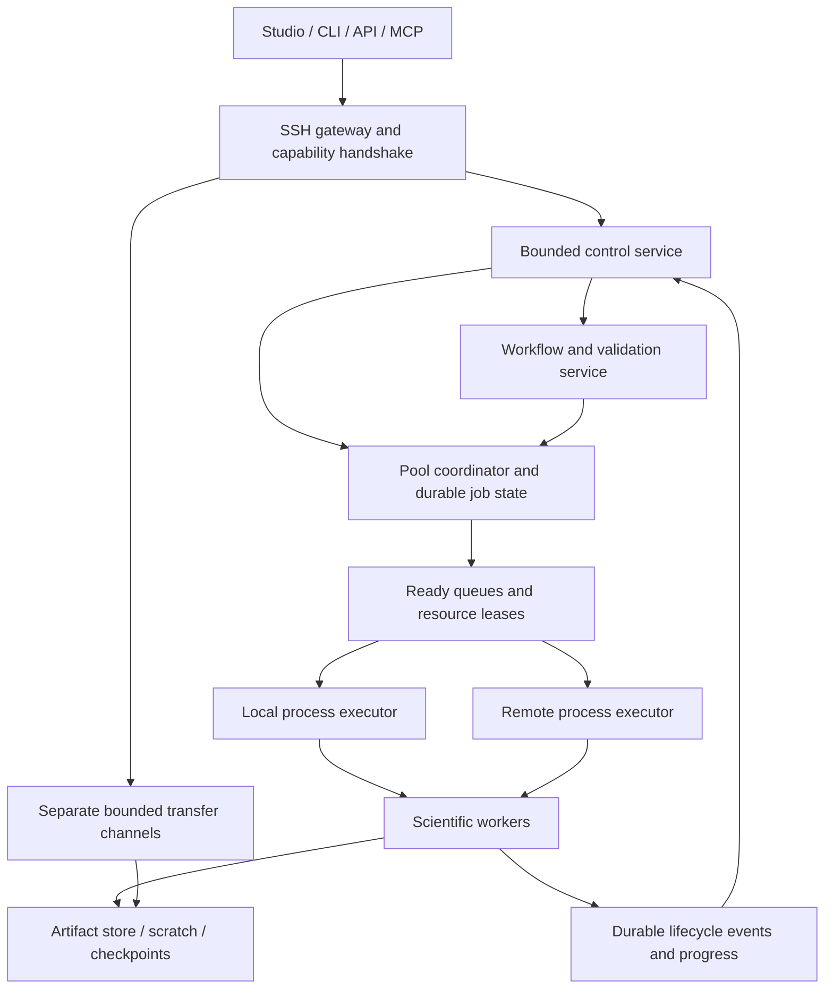

# Next execution engine: concurrent clients, bounded resources and recovery

Status: design proposal, 2026-11-07. The implemented subset, evidence and
remaining boundaries are recorded in
[the implementation status](server_engine_progress.md).  This document remains
the architecture target; individual proposals below are not release behavior
until the progress record marks them implemented.
Baseline: Operon 3.0.2 application commit
`c7bd2c6d73c600e899121f335a267c2c64140d94`, SDK revision 3.7.
The application and independently maintained library remain separate.

For ordered coding tasks, exact refactor seams, acceptance tests and rollout
instructions, use the [implementation handoff plan](server_engine_implementation_plan.md).

## 1. Goal and preserved decisions

Make a server responsive and predictable when multiple Studio, CLI, API and MCP
clients submit and observe work concurrently. Improve backend queueing and
resource use before considering a Tauri desktop-host replacement. Reusing the
frontend and replacing its host must not create a second execution engine.

Preserve frozen per-workflow parameter JSON and execution configuration, pinned
implementations, metadata-first discovery, explicit environment preparation,
memory planning, mapped inputs, emergency spill and SSH-based access. Installing
or connecting a client must not install scientific dependencies automatically.

The pool ceiling comes from the existing startup snapshot and an explicit owner
configuration; its default remains 90% of the detected available memory. Dynamic
scheduling redistributes allocations *inside* that ceiling. It does not repeatedly
recalculate the ceiling from fluctuating system free-memory readings. Pressure
telemetry may suspend new admissions and trigger existing emergency mechanisms.

## 2. Verified baseline and gaps

| Current source | Verified behavior | Consequence |
| --- | --- | --- |
| `operon/remote/server.py:serve` | One accept/read/dispatch/reply sequence at a time for a workspace daemon | A slow dispatch or client can delay unrelated control requests |
| `operon/remote/client.py:SSHConnection.call` | One locked request/reply exchange per connection | Long work and transfers can delay cancellation/status on that channel |
| `src/web/admission.py:HostAdmission` | File-locked CPU/RAM reservation ledger shared under the same OS user; fixed live-session ceiling | Prevents some oversubscription, but is not a central fair queue |
| `src/web/service.py:_dispatch` | FIFO within the owning launcher, stopping at the first reservation that cannot fit | Idle resources and competition between workspaces are possible |
| `src/task/runner.py:run` | Fixed step order in each scientific worker | Multiple jobs/stages can run, but this is not general node-level DAG scheduling |
| `operon/isolation.py` and `operon/remote/protocol.py` | Pull/acknowledgement at selected chunk/frame boundaries | Local flow control exists; whole-DAG backpressure does not |

These are code findings, not measured latency regressions. Existing reservation
accounting must not be described as either absent or a complete dynamic engine.

## 3. Architecture and ownership



Default coordination scope is **one OS account and execution pool**, covering all
of that account's workspaces and client connections. Socket identity and directory
ownership authenticate local gateways; a request-supplied client ID is not an
authorization boundary. Separate SSH users do not become one security domain.
A host-wide, multi-account pool requires an explicitly administered service with
authenticated principals and policy; do not achieve it by making a ledger writable
by every user. Nested cgroups and different allocated machines are distinct
capacity domains and must not be added as if they were independent host RAM.

| Component | Owns | Must not do |
| --- | --- | --- |
| Gateway | Sessions, authentication, protocol negotiation, deadlines | Own scientific job lifetime |
| Control service | Short requests, immutable status snapshots, subscriptions | Run installation, hashing or scientific code inline |
| Workflow service | Frozen graph/values/config, validation receipt, compiled plan | Refill saved values from current operator defaults |
| Pool coordinator | Global queue within its scope, leases, attempts, lifecycle | Block while spawning workers or sending network data |
| Executor | Process tree launch/stop, environment selection, worker communication | Independently grant resources already owned by the coordinator |
| Worker | One attempt or declared streaming group, local memory planning | Change a reservation without acknowledgement |
| Artifact service | Publication, verified reuse, retention and references | Treat an incomplete file as a completed result |

A service remains alive while it owns queued work, active attempts, transfers or
maintenance operations. Desktop disconnection only detaches a session. A session
timeout must never imply job cancellation. Deployment shutdown explicitly drains,
then stops according to policy; successful results remain reconnectable.

## 4. Control-plane concurrency first

Replace the serial daemon loop with bounded request admission. Slow/unresponsive
sockets get deadlines and cannot occupy every handler. Introduce concurrency only
after auditing `JobService`, registry refresh, transfer leases and shutdown state:
adding an unbounded thread pool around the existing mutable service is unsafe.

Use a short single-writer coordinator command loop for state transitions, with
immutable read snapshots for status/list queries. Disk scans, subprocess launch,
environment preparation and checksum work run outside that loop in bounded
executors and post results back with revision/attempt checks.

Separate logical channels and execution budgets:

- **Control:** submit, cancel, status, capability handshake; reserve handler/CPU
  capacity so bulk work cannot consume all control slots.
- **Events:** durable lifecycle cursor plus coalesced progress; per-subscriber
  byte bounds and resumable delivery.
- **Bulk/maintenance:** uploads, downloads, registry builds and environment
  preparation; bounded concurrency and I/O reservations.

Initially use separate SSH channels with the existing transport. Do not merely
remove `SSHConnection.call`'s lock and allow replies to race on one byte stream.
Request IDs, deadlines and idempotency keys support a future multiplexed protocol.
Long operations return an operation ID promptly; polling/subscriptions reference
that operation. Dependency repairs are deduplicated per environment target and
publish a new immutable ready receipt only on success.

## 5. Durable state and request contracts

Use local SQLite WAL for job/attempt/lease/event transactions and a single writer;
keep bulky logs and artifacts in files. Do not place the coordinator database on
NFS or use it as a distributed database. Existing job manifests remain importable
and exportable; migrating live ownership requires an explicit drain/recovery path.

Minimum persisted records:

| Record | Identity and essential fields |
| --- | --- |
| Workflow run | `run_id`, principal/project, graph revision, frozen inputs/parameters/config, plan identity |
| Execution unit | node/stage/group ID, dependencies, required capabilities, resource envelope, state |
| Attempt | unit ID, attempt number, coordinator epoch, worker process identity, timestamps, result |
| Resource lease | attempt ID, committed RAM/CPU/device/scratch allocations, expiry/heartbeat, state |
| Artifact | immutable ID, format and metadata, digest, producer attempt, publication state, references |
| Event | monotonic cursor, owner, run/attempt, event type, revision and compact payload |
| Operation | request idempotency key, principal, request digest, operation ID, retained response |

Proposed commands behind the existing CLI/API/MCP adapters:

- `submit(plan, validation_receipt, idempotency_key)` -> durable run/operation ID.
  The key is scoped to an authenticated principal; reuse with different content
  is an error. Lost replies do not cause another run.
- `cancel(run_id, expected_revision)` -> durable cancellation acknowledgement,
  followed by actual worker termination status; acknowledgement is not completion.
- `status(run_id, since_revision)` and paginated `list(filter, cursor)` -> compact
  snapshots. Large registries and complete logs are never embedded here.
- `events(after_cursor, filters)` -> ordered lifecycle events and bounded progress.
- `lease_request/enlarge/release(attempt_id, epoch, revision)` -> atomic decision.
  Workers cannot claim a new allowance by changing their local memory setting.

Add server capabilities such as concurrent control, resumable events and resource
leases to handshake negotiation. This is a server protocol evolution, not an
excuse to require another operator schema rewrite. Older clients can use a
supported compatibility adapter; unsupported operations fail explicitly.

## 6. Dynamic resource planning

### Capacity and accounting

Let `C` be the configured/startup pool ceiling and `H` the management/control
reservation within that ceiling. Admissions maintain:

`sum(active committed RAM leases) + transfer allowance + shared-store allowance <= C - H`.

Define charges so shared buffers are counted once in the pool; per-job views may
attribute them separately but may not sum those views as physical usage. Resident
input blocks, pinned mappings, operator workspace, output buffers and IPC buffers
are distinct categories. Disk spill is charged to scratch capacity and I/O slots;
moving RAM pressure to an unlimited disk queue is not a solution.

Each unit has a minimum feasible memory grant, preferred grant, explicit upper
bound, CPU/thread requirement, scratch requirement, and optional device requirement.
Derive these from existing declarations/profiles and input metadata first. Record
observed peaks to improve later estimates, keyed by implementation/environment and
input size class. Estimates are not hard guarantees and must not cause speculative
overcommit of fixed full-mode operators.

### Reallocation rules

1. Allocate committed grants before dispatch. A full-mode legacy operator has a
   fixed grant for its attempt; do not reduce it halfway through a BLAS call.
2. Flexible grants are available only to workers with an explicit cooperative
   resize capability. Resize at a chunk or node boundary. Return credits only
   after the worker acknowledges eviction/release; low sampled RSS alone is not
   evidence that memory can safely be granted twice.
3. Releasing an attempt or committed stage immediately wakes queued work. If an
   enlargement is refused, shrink supported chunks, spill eligible blocks or wait
   at a resumable boundary. A fixed-mode worker fails with an actionable resource
   error rather than acquiring an undeclared allowance.
4. Pressure telemetry pauses new work and invokes emergency spill. Existing
   process-tree monitoring remains; Linux cgroup enforcement is optional and must
   report whether delegated permissions actually permit it. Environment variables
   alone do not enforce native-library thread counts or a hard RSS limit.
5. Cooperative expansion uses idle capacity; it may not steal protected capacity
   from an older waiting job. GPU support starts with explicit exclusive device
   leases; sharing needs measured per-tool support, not just a free-VRAM query.

An explicitly configured fixed workflow budget stays fixed. Flexible scheduling
is a separate opt-in execution policy; it must not rewrite `execution.json` or
silently reinterpret a saved fixed budget. Persist the actual attempt grant and
resize history separately from the requested configuration. Resource usage
calibration changes future planning, never the scientific parameter values.

A flexible unit must be able to make forward progress at its advertised minimum.
If all workers retain grants while waiting for growth that none can release, the
system deadlocks. Therefore growth is optional for a flexible unit; it must shrink
chunks/spill or reach a safe checkpoint on refusal. A unit requiring additional
RAM to proceed is full-mode for that region and must acquire its feasible grant
before entering it, or stop/requeue through a supported checkpoint.

### Worked cooperative allocation example

Suppose startup detects 64 GiB available. A 90% pool is 57.6 GiB; after a configured
1.6 GiB management reservation, the example has 56 GiB for the following workers.
These figures are illustrative, not hardcoded defaults; shared buffers and
transfer reservations must also be deducted when present.

| Worker | Minimum | Preferred | Initial grant | Target after D joins |
| --- | ---: | ---: | ---: | ---: |
| A | 16 GiB | 32 GiB | 24 GiB | 20 GiB |
| B | 8 GiB | 16 GiB | 16 GiB | 12 GiB |
| C | 8 GiB | 16 GiB | 16 GiB | 12 GiB |
| D | 8 GiB | 16 GiB | Queued | 12 GiB |

All four are assumed cooperatively resizable, equally weighted, CPU-feasible and
within scratch limits. Allocate feasible minima, then distribute surplus toward
preferred grants using weighted water filling. This is a local allocation rule,
not a globally optimal runtime solution or an assumption about every operator.

A/B/C first acknowledge releasing 4 GiB each at safe boundaries. Only then may D
receive those credits and start. Until acknowledgements arrive, the *committed*
grants remain 24/16/16 and D remains queued; target grants are not free memory.
If A/B/C are ordinary full-mode operators, this redistribution is unavailable and
D waits for completion. A newly connected desktop cannot force unsafe shrinkage.

This example assumes a verified process-reservation release capability. The
existing managed-store budget hook alone does not establish it: native allocators
may retain resident memory after eviction. The initial implementation keeps those
process credits charged until completion or a verified supervisor handoff/restart;
see the implementation plan for distinct managed/process budgets and ACK rules.

### Fair scheduling without expensive global optimization

Queue by principal/project, not by connection: opening ten windows must not grant
ten shares. Initially use weighted fair selection with ageing and per-project
admission caps. Compare committed dominant resource shares when multiple resource
dimensions are available; keep the policy deterministic and explain decisions.
Projects inherit an authenticated principal's aggregate quota; creating extra
project names must not manufacture extra capacity or scheduling weight.

On submission, completion, dependency readiness, lease release or a bounded
heartbeat, update dependency counters and ready queues. Examine a bounded set of
ready candidates and atomically acquire their complete resource set. Perform
process launch outside the state lock, then reconcile launch success/failure.
Do not enumerate all possible node subsets or rescan every input file per tick.

Allow small jobs to fill idle space only while preserving a protected reservation
for an aged, feasible large job. Without trustworthy runtime bounds or cooperative
preemption, do not promise safe time-based backfill: stop new competing admissions
when needed to accumulate that reservation. An oversized job is rejected, not
left in an impossible queue. Fairness assumes running finite work eventually
releases resources; optional execution deadlines are explicit policy.

Multiple-server placement uses readiness, data locality, transfer cost and queued
capacity, with an explainable choice. Freeze placement for a running unit; do not
chase transient load by repeatedly moving its data. Manual placement and the
existing uniform environment rule for a route operator remain authoritative.

Proposed event-driven scheduling cycle:

```text
receive durable completion/submission/lease-change event
  update affected dependency counters and ready entries
  choose a bounded set of aged/fair candidates
  check complete resource and execution-capability requirements
  transactionally reserve resources + create fenced attempt + record event
  enqueue launch outside the coordinator state lock
receive launch acknowledgement/failure
  mark attempt running, or reconcile and release its reservation
```

Resource-profile estimation, environment installation, hashing and process launch
must not occur while selecting candidates under the coordinator state lock.

## 7. Execution units and whole-DAG backpressure

Roll out execution granularity progressively:

1. Existing complete jobs/stages under the shared coordinator.
2. Independent ready DAG branches as separate units, accounting for duplicated
   interpreter/input overhead before selecting parallelism.
3. Groups of explicitly streaming-capable nodes joined by bounded channels.

Keep a sequential path for legacy operators. No AST analysis can establish that
an arbitrary Python/R/C/C++ program is safely streamable. Do not add mandatory
runtime hooks to every library operator; capability adapters opt in, and absence
means full-mode, non-resizable, non-preemptible execution.

For streaming channels, bound **bytes and in-flight blocks**, not just item count:

- The producer obtains credits before allocating/reading/enqueueing a block.
  Block capacity accounts for decoded size and metadata, not compressed bytes.
- The consumer acknowledges release after processing. Its acknowledgement returns
  credits; queue saturation suspends the producer at its cooperative boundary.
- Fan-out uses immutable block references and consumer acknowledgements. A slow
  required branch retains its reference and eventually applies upstream pressure.
  Optional disk decoupling needs its own bounded lease and an explicit policy.
- Ready data without a scheduled consumer must not consume every resource. Admit
  a feasible streaming group with enough capacity to make end-to-end progress,
  reserve minimum channel/consumer resources, and reject unsatisfiable groups.
- Joins declare ordering, buffering and partition constraints. Missing inputs
  cannot cause unbounded buffering. Cancellation and failed consumers close the
  channel and release/retain resources according to attempt recovery state.

This is distinct from current pull-based Reader chunks and SSH frame ACKs.
End-to-end backpressure needs actual producer/consumer overlap and explicit
bounded ownership, not only an arrow or a chunk-size parameter.

## 8. Lifecycle, recovery and scratch

Unit states: `blocked -> ready -> admitted -> starting -> running -> committing
-> succeeded`, with explicit failed/cancelled outcomes and a separate cancellation
request flag. Retry creates a new attempt; it does not rewrite the old attempt.
Pause/resume is exposed only where a durable, supported checkpoint exists.

Proposed attempt-owned layout:

```text
workspace/.studio/runs/<run>/
  graph.json  parameters.json  execution.json  plan.json
  nodes/<node>/attempts/<attempt>/
    tmp/  spill/  ipc/  output-staging/  logs/  checkpoint.json
  results/manifest.json
```

Use immutable artifact publication with checksums and an atomic commit manifest.
Cross-filesystem moves require staged copy/verification before publication. Downstream
work consumes only committed artifacts. Attempt fencing prevents a delayed old
worker from publishing over a newer attempt. This provides controlled publication,
not exactly-once execution of arbitrary external side effects.
The filesystem and state database do not share a transaction: durable commit
receipts and restart reconciliation must handle a crash between artifact rename
and database registration. Automatic retries are bounded and restricted to
classified transient failures with safe replay semantics; validation errors,
scientific errors and unknown external side effects need explicit resolution.

A missing client heartbeat does not cancel a job. A missing worker heartbeat
enters suspect/reconciliation state; it does not immediately release memory while
the worker may still be alive. Confirm process identity/death or fencing before
reclaiming the lease. Coordinator restart reconciles durable attempts and workers,
rebuilds queues, and reports uncertain ownership rather than launching duplicates.

Resume keys include resolved input content identities, frozen parameter values,
implementation pins, relevant I/O semantics, environment/tool identities and
converter versions. Presentation text and current parameter defaults do not change
the identity of frozen execution. File size/mtime can accelerate discovery but are
not proof for content-verified scientific cache reuse. Hash incrementally while
reading/uploading or reuse a verified immutable artifact digest.

Cleanup follows references, state and retention policy. Preserve committed outputs,
live attempts and checkpoints selected for resume. Failed-attempt retention is
configurable; garbage collection marks candidates before deleting them, records
its actions, and verifies ownership/path boundaries. Stale spill/IPC files do not
become successful outputs. Clients can inspect usage and request scoped cleanup.

## 9. Response time and observability

Measure before optimizing: client queueing, network round trip, server request
queueing, handler execution, state lock time, scheduling, worker startup and UI
rendering are separate spans tied to request/run/attempt IDs. Record control
latency histograms, ready-to-start delay, queue age, resource utilisation, retained
scratch, event backlog and duplicate submissions. Keep diagnostics local by
default; never log credentials or whole scientific payloads.

Use incremental events/cursors for job changes and logs; serve cached snapshots
for read-heavy lists. Reconnection requests missing events and uses a snapshot
fallback when the retained event window has expired. Coalesce progress updates;
persist terminal transitions and artifact publication events. A slow subscriber
cannot block a scientific worker. Legacy polling remains bounded with backoff.

Initial performance acceptance targets (provisional; **not measured claims**):

| Test condition | Target |
| --- | --- |
| 16 concurrent clients with bounded upload and compute load | Server-side p95 status/cancel-ack latency <= 200 ms on the declared reference host |
| Same-host comparison with 3.0.2 | At least 50% lower p95 control latency under mixed load, without material idle-regression |
| Healthy connection | User-visible status update <= network RTT + 1 second |
| Resource release with an immediately feasible ready unit | Dispatch decision within 500 ms, excluding environment preparation/process startup |
| Saturated streaming producer plus slow consumer | Buffered bytes plateau at configured credits; no upward drift with run duration |

Record actual hardware, quotas, workload, repetitions, warm/cold state and network
impairment. Publish distributions, not one best-case timing. If a target proves
unrealistic, revise it with measurements before making a product claim.

## 10. Delivery sequence and acceptance gates

| Stage | Deliverable | Required evidence |
| --- | --- | --- |
| E0 | Trace IDs, baseline benchmarks, stable service interfaces | Reproduce serial head-of-line blocking with two real clients and a slow operation |
| E1 | Bounded concurrent control; separate transfer/event channels; short state locks | Slow socket/upload/maintenance cannot block another client's cancellation/status; concurrent state mutation is consistent |
| E2 | Shared per-pool coordinator, fair queue and durable resource leases | Multiple workspaces and 1/4/16 clients; no double allocation, connection-based quota evasion, unexplained starvation or cancelled-job launch |
| E3 | Unit lifecycle, immutable outputs, reference-counted scratch and recovery | Coordinator/worker termination at each state boundary; safe retry, no stale publish, no premature lease release |
| E4 | Ready-node parallelism and cooperative dynamic budgets | Independent branches overlap within CPU/RAM/disk grants; full-mode jobs retain safe budgets; correct outputs |
| E5 | Bounded streaming groups and whole-DAG backpressure | Fast producer/slow consumer, fan-out/join, full scratch and consumer failure; bounded queues and no deadlock |
| E6 | Further executors and desktop-host evaluation | Measured need, compatible APIs and independent executor/host acceptance |

At each stage test concurrent submit, duplicate retries, disconnect/reconnect,
lease recovery, dependency preparation deduplication, competing small/large jobs,
failure during result publication, and a consumer that never reads. Verify both
control responsiveness and numerical/artifact equivalence. Preserve existing CLI,
MCP, desktop, memory/spill, streaming, SSH and frozen-parameter regression tests.

Initial placement for new application modules is `operon/engine/` with bounded
responsibilities: `state`, `coordinator`, `resources`, `policy`, `executors`,
`channels`, `artifacts`, `recovery`, and `events`. These are proposed interfaces,
not existing files. Extract adapters from the current services incrementally;
run the sequential executor behind the new interfaces first. During migration,
one pool has one authoritative admission owner; old and new allocators must not
each promise the same capacity.

Tauri is evaluated after E1-E3 measurements establish the remaining desktop cost.
Keep workflow/API/IPC contracts host-independent. Desktop packaging/startup and
server scheduling have separate benchmarks; replacing the desktop host is not
evidence of improved server concurrency. This proposal neither commits to a new
desktop framework nor introduces Ray, Kubernetes or another distributed platform
without a demonstrated workload need.
